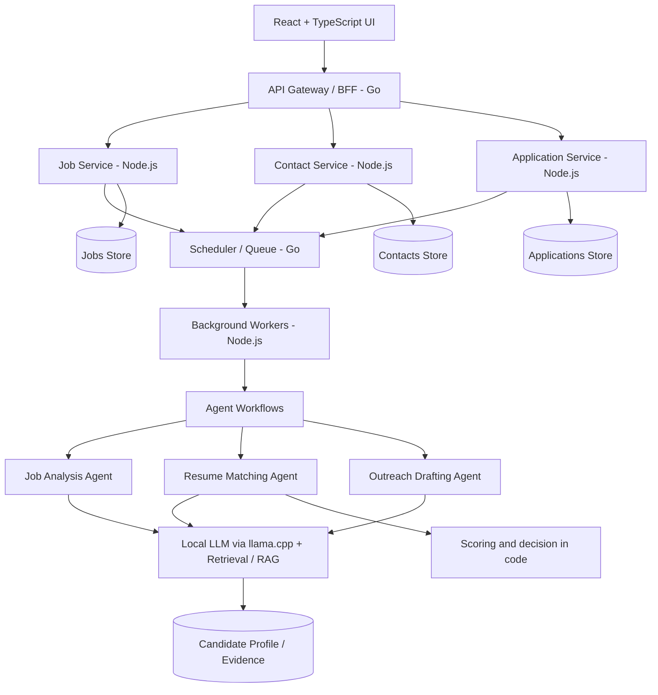

# JobOps

**JobOps is a personal, AI-powered job-search operations platform** designed to turn job discovery into a structured workflow: evaluate opportunities, understand skill gaps, find relevant professional contacts, prepare tailored outreach, and track outcomes.

The project has two goals:

1. Build a useful system for managing a real job search.
2. Demonstrate senior-level full-stack, backend, distributed-systems, and AI-agent engineering through a working product.

> **Project status:** This README reconstructs the intended product and architecture from the original plan. It does not claim that every component has been implemented. The source code was lost, so the implementation status, exact repository structure, and final technology choices still need to be verified.

## Table of contents

- [Why JobOps?](#why-jobops)
- [Core workflow](#core-workflow)
- [Planned architecture](#planned-architecture)
- [Core components](#core-components)
- [Technology direction](#technology-direction)
- [Data domains](#data-domains)
- [AI and retrieval principles](#ai-and-retrieval-principles)
- [Reliability and engineering goals](#reliability-and-engineering-goals)
- [Implementation roadmap](#implementation-roadmap)
- [Privacy and safety](#privacy-and-safety)
- [Project status](#project-status)
- [Guiding principle](#guiding-principle)

## Why JobOps?

Job searching often involves disconnected tools, repeated manual work, generic applications, and little feedback about which actions are effective.

JobOps aims to bring those activities into one workflow. Rather than merely storing job links or generating generic AI text, it should produce **traceable, evidence-based recommendations**:

- Why is a role a good or poor fit?
- Which requirements are supported by demonstrated experience?
- Which requirements are missing or uncertain?
- What should be learned or prepared before applying?
- Is there a relevant person in the user's existing professional network?
- What is the next useful action, and what happened after it?

The system should support decisions rather than make career decisions on the user's behalf.

## Core workflow

1. **Discover jobs** — ingest job postings from supported sources.
2. **Normalize and deduplicate** — store consistent job records and identify duplicates.
3. **Parse job descriptions** — extract skills, responsibilities, qualifications, seniority, and other requirements.
4. **Match against a candidate profile** — compare requirements with evidence from the user's resume and verified experience.
5. **Score and explain fit** — produce a reasoned assessment, including missing evidence and uncertainty.
6. **Plan the application** — suggest preparation topics and relevant resume adjustments.
7. **Find relevant contacts** — search the user's authorized local contact dataset for people connected to a target company or role.
8. **Draft outreach** — prepare personalized messages using available, relevant context.
9. **Review and track** — require human approval before sending messages and track applications, responses, and outcomes.

### Example

For a newly discovered backend engineering role, JobOps should be able to:

- Save the posting and its source.
- Extract the required technologies and seniority expectations.
- Compare those requirements with evidence in the candidate profile.
- Explain strengths, gaps, and uncertain matches.
- Recommend whether to apply now, prepare first, or skip the role.
- Search authorized contacts for relevant connections at the company.
- Draft an outreach message for the user to review.
- Record the user's decision and subsequent outcome.

## Planned architecture

The architecture below is the **intended logical design**, not a claim about deployed or completed services.

### Architectural intent

- Business services (jobs, contacts, applications) and workers are written in Node.js + TypeScript.
- Go is the control layer over them: the API gateway is the single entry point (routing, rate limits, auth), and the scheduler/queue decides what runs when, dispatches work to Node workers, and retries failures.
- Go also runs the JD fetcher (`jd-search`): many concurrent requests to public job-board APIs, with per-host rate limits and retries. It hands postings to the Node job service through `POST /jobs`.
- Local Kubernetes supervises every service (start, stop, health checks, restarts), so supervision is not written in Go.
- Keep the user-facing API separate from long-running AI and ingestion work.
- Separate job, contact, and application responsibilities where doing so provides a real benefit.
- Use background processing for slow, retryable tasks.
- Keep model inference behind a defined interface so models can be changed without rewriting business logic.
- Persist important workflow state and AI results rather than relying on conversation history.
- Start with the smallest working deployment and introduce additional services only when their boundaries are justified.

## Core components

| Component | Responsibility |
|---|---|
| Frontend | Search jobs, inspect match explanations, review contacts, manage applications, and approve outreach |
| API Gateway / BFF (Go) | Single entry point: route to Node services, rate limits, auth, and coordinate service calls |
| Job Service | Ingest, normalize, deduplicate, store, and query job postings |
| Contact Service | Index and search authorized contacts and relevant professional context |
| Application Service | Track application stages, decisions, activities, and outcomes |
| Scheduler / queue (Go) and workers (Node.js) | Schedule and dispatch background jobs to Node workers, with retries, without blocking API requests |
| Job Analysis Agent | Extract and structure role requirements |
| Resume Matching Agent | Compare requirements against candidate evidence and identify gaps |
| Outreach Agent | Prepare contextual outreach drafts for human review |
| Local LLM runtime | Provide inference and structured outputs through a replaceable interface |
| Retrieval / RAG layer | Retrieve relevant job, resume, and contact evidence for AI tasks |
| Persistent stores | Keep job, candidate-profile, contact, application, and task data durable |

These are logical responsibilities. They do not require every component to be a separate microservice in the first version.

## Technology direction

The original plan explored the following technologies. Exact assignments and versions should be decided during reconstruction, based on implementation needs and available hardware.

| Area | Planned technologies / concepts |
|---|---|
| Frontend | React, TypeScript |
| Business services and workers | Node.js, TypeScript, REST (Fastify, Zod, SQLite to start) |
| Control layer | Go: API gateway and scheduler/queue in front of and over the Node services |
| AI and agent workflows | Python, local LLMs via llama.cpp, tool calling, structured outputs |
| Retrieval | Embeddings, indexing, semantic search, RAG |
| Data | Relational storage, appropriate indexes, caching |
| Asynchronous work | Queues, workers, scheduling, event-driven processing |
| Packaging | Docker |
| Orchestration | Local Kubernetes: runs and supervises all services (health checks, restarts) |
| Cloud and object storage | AWS, S3, RDS as appropriate |
| Engineering practices | Automated tests, CI/CD, observability, secure configuration |

The project is not intended to use every technology merely to list it on a resume. Each addition should solve a concrete problem and be explainable in terms of trade-offs.

## Data domains

The initial data model should cover at least these domains:

### Job

Potential fields:

- `id`
- `title`
- `company`
- `location`
- `description`
- `source_url`
- `source_name`
- `employment_type`
- `seniority`
- `required_skills`
- `preferred_skills`
- `posted_at`
- `first_seen_at`
- `last_seen_at`
- `content_hash`

The precise schema should be finalized during implementation. A stable source identifier or content fingerprint can help detect duplicate postings.

### Candidate profile and evidence

Represent the candidate's skills and experience using evidence from approved resume content and verified project history. A match should distinguish:

- Supported by explicit evidence.
- Partially supported or transferable.
- Not demonstrated.
- Unknown because the source material is incomplete.

AI must not invent experience, metrics, employers, dates, or accomplishments.

### Contact

Potential fields include:

- `id`
- `name`
- `company`
- `role`
- `profile_url`
- `relationship_context`
- `source`
- `last_updated_at`

Only data the user is authorized to access and process should be imported. Avoid collecting unnecessary personal information.

### Application and evaluation

Track the relationship between a job and the user's decision:

- Job reference.
- Current stage and decision.
- Match assessment and evidence.
- Identified skill gaps.
- Preparation actions.
- Outreach drafts and approval status.
- Activity history and outcome.

AI-generated assessments should be versioned or timestamped so they can be regenerated when the resume, job description, prompt, or model changes.

## AI and retrieval principles

JobOps should use AI as a component of a reliable application, not as the source of truth for all application state.

1. **Retrieve before generating.** Supply relevant job requirements and candidate evidence to the model.
2. **Prefer structured output.** Validate model responses against schemas before saving or acting on them.
3. **Separate facts from inference.** Mark uncertain matches and require evidence for important claims.
4. **Keep tools constrained.** Agents should have explicit, limited capabilities rather than unrestricted access to the system.
5. **Make workflows reproducible.** Record useful metadata such as model identifier, prompt/version, timestamps, and evaluation status where appropriate.
6. **Handle model failure.** Invalid output, timeouts, and unavailable models must not corrupt application data.
7. **Keep humans in control.** Recommendations and message drafts are reviewable; external messages are not sent automatically.

### Model roles

Generation and judgment are handled by different kinds of models. All of them run locally, so resumes and contacts stay on the machine.

Each model call names its task; `api/config/models.yaml` says which model and server each task uses, with its timeout and answer limit (override in `profile/models.yaml`). Every command checks its model's server before starting and, if it is down, stops with the commands to switch (one large model fits in memory at a time). Each call adds one line to `data/model-calls.jsonl` (task, model, outcome, time, tokens; never prompt or answer text); `models stats` summarizes it.

| Task | Model | Notes |
|---|---|---|
| Extract requirements from job posts into JSON | Local LLM (`qwen2.5:7b`) via llama.cpp | Output forced to a schema and validated before saving |
| Judge evidence per requirement (supported / partial / not shown) | Local LLM (`qwen2.5:7b`) via llama.cpp | Only for what the inverted index cannot settle; one requirement and its candidate bullets per call, a few calls at once; verdicts cached per bank |
| Decide fit (reuse / adapt / not tailored) | Code, from per-requirement scores | Years are a hard gate; bands and caps in `api/src/scoring/config.ts` |
| Verify tailored resume bullets are backed by real experience | Code (rewrite guard) | Rejects any rewrite that adds a number, term, or scope, AI-sounding wording, or hidden characters |
| Rewrite resume bullets | Local LLM (`qwen2.5:14b`) via llama.cpp | Prompt and guard carry humanizer rules (adapted from blader/humanizer, MIT); every change is logged in the resume record for review |
| Draft outreach | Local LLM via llama.cpp | Every message needs user approval |

Laya was considered for judging and dropped (2026-10-28): zero-shot it judged 7 of 17 trial cases right against 12 of 17 for `qwen2.5:7b`, and calibrating it would need a hand-labeled set.

### Development workflow

Claude Code plans each milestone, writes task specs, and reviews and tests the code. A local coding model on llama.cpp writes well-defined pieces from those specs.

This applies from Milestone 1 onward. It is separate from the models JobOps itself uses: the product needs no model until Milestone 3 (matching) and Milestone 4 (local LLM integration), but the coding model helps build every milestone.

## Reliability and engineering goals

The system should grow toward production-quality behavior incrementally.

- **Idempotency:** retrying a job should not create duplicate records or duplicate side effects.
- **Durable task state:** queued work should have explicit states, such as pending, running, succeeded, failed, and retrying.
- **Bounded retries:** transient failures may be retried with backoff; permanent failures should be surfaced.
- **Concurrency control:** prevent workers from processing the same task unsafely.
- **Rate limiting:** respect upstream source limits and avoid excessive requests.
- **Input validation:** treat job descriptions, imported contacts, and model output as untrusted input.
- **Testing:** cover business logic, API contracts, persistence, queue behavior, and AI-output validation.
- **Security:** keep credentials out of source control and protect local contact data.
- **Operational visibility:** expose enough logs and task status to diagnose failures without logging unnecessary private content.

Kubernetes, multiple services, and distributed queues should be introduced when the workload or learning objective justifies them—not before the core workflow works.

## Implementation roadmap

The original plan emphasized small, testable deliverables. The sequence below reconstructs that plan.

### Milestone 1 — Working job API

- Define the initial job schema.
- Implement `POST /jobs` and basic validation.
- Add persistence and retrieval.
- Write tests for valid and invalid requests.

### Milestone 2 — Search and deduplication

- Implement job listing and filtering.
- Add a stable deduplication strategy.
- Track source and ingestion timestamps.
- Test duplicate and update behavior.

### Milestone 3 — Candidate profile, matching, and resume selection (done, 2026-10-28)

- Parse the resume once into a user-approved YAML experience bank; record skills the resume omits as user-confirmed extras. Career breaks are part of the timeline but add no years or tenure.
- Minimal local model provider (llama.cpp, schema-forced and validated output, timeouts, streamed answers), pulled forward from Milestone 4.
- Extract job requirements into a validated structure.
- Search job boards by the user's preferences with a concurrent Go fetcher: Greenhouse, Lever, Ashby, Workday, SmartRecruiters, and company careers sites through a browser crawler that honors robots.txt. `job add <url>` takes one job by its link through the whole flow.
- Score the bank against each JD: strengths, gaps, evidence, and questions about skills the bank lacks. An inverted index settles what it can; a local LLM judge decides the rest. Degrees are checked against education; soft skills count as themes and never cap the score.
- Resume selection engine: reuse an existing resume, adapt one, or mark the JD not tailored (years, or a poor fit); one traceable YAML resume record per JD. Rewrites pass a guard: no added numbers, terms, or scope, no AI-sounding wording, no hidden characters.
- PDF from an ATS-tested template (company line first, dates beside the title), kept only when three local readers (pdftotext, pdf.js, OpenResume) read every field back. Layout verified on Workday with a fake resume. Resume lint flags gaps, tenure, and wording issues for the user.
- Expose the tools as MCP servers (Node and Go).

### Milestone 4 — Local LLM integration

- Generalize the model-provider interface from Milestone 3: one registry (`api/config/models.yaml`) for every task's model, server, timeout, and answer limit.
- Move remaining extraction and judgment steps onto it: JD parsing, the judge, the bank build, retagging, and rewording all call by task.
- Validate structured responses: schema-forced output, Zod validation, one retry that names the failing fields.
- Handle timeouts, malformed output, and model unavailability: a preflight check before every model command, batches that stop at the first server failure, and a call log of outcomes and timing.

### Milestone 5 — Background agent workflow (done, 2026-11-03)

- Build the Go scheduler/queue; Node workers pull and run its tasks: `queue/` (Go, SQLite tables `queue_batches` and `queue_tasks` in `data/jobops.db`), one queue per stage (fetch, parse, score, tailor). `worker laptop` runs parse and score, `worker mac` runs tailor.
- Queue evaluation tasks: `batch start [--limit N]` (1–100, default 100) searches the job boards, then takes up to N jobs, newest first, skipping finished ones. Each job moves to its next stage as soon as its task ends; tailor only for reuse or adapt.
- Track task state and failures: `batch status [id]` shows per-stage counts and each failure's code.
- Make task submission and retries safe: one task per job, stage and prompt version; timeouts and unreachable servers retry after 30 s and 60 s (3 attempts); invalid output fails at once; an expired lease returns the task to the queue; `batch retry <id>`.
- Persist the result and expose it through the API: results stay in the existing tables; `/batches` routes mirror the commands.
- Split models: JD parse and the judge run on a second machine (general7 on an RTX 3050 laptop, API key, `LLM_GENERAL7_URL` and `LLM_GENERAL7_KEY` in `.env`); the Mac keeps general14 for rewording. Parse and score share the laptop's 3 slots; tailor runs 3 at a time on the Mac.
- JD prompt v2 (must-have rules, short items, one example) and Qdrant before parsing: a repost of a JD parsed before reuses that parse, and a keyword is renamed to its canonical name only when that name is in the JD (similar and contained, so siblings like PostgreSQL and MySQL never merge).
- The extension's report loop must raise the score: each round is re-scored by the engine, the loop stops at the first round without a gain (at most 5), the best version stays current, and the chat's `fit_score` is recorded beside the engine score.
- Search filters from `profile/preferences.yaml`: a title needs a role title or alias, a `seniority.include` word or level (III, 3) unless the role has `any_level`, and no `seniority.exclude` word. A title that names a language the user does not work in (`title_filter`) is skipped. A stated INR salary below `compensation.min` is skipped, and posts without one are kept when `keep_if_unlisted` is set. LeetCode Discuss is left out: its terms forbid scraping, so jobs found there go in by hand with `job add <url>`.
- Stored jobs are checked again before every batch (`jd-search check`), so a job saved by an older search is skipped once the preferences exclude it; `batch status <id>` shows the skips by reason.
- First real batches: 6 jobs fetched, parsed and scored on the laptop, no failures.
- How to run it: [RUNBOOK-M5.md](RUNBOOK-M5.md) (`.claude/bin/batch-up.sh` brings everything up).

### Milestone 6 — Contact search and outreach

- Import a user-authorized contact dataset.
- Search contacts by company, role, and relevant context.
- Draft outreach messages.
- Add an explicit approval step before sending or copying a message to an external service.

### Milestone 7 — UI and application tracking

- Build the job dashboard and job detail view.
- Show evidence-backed fit assessments.
- Track decisions, preparation tasks, and application outcomes.
- Make failed or incomplete workflows visible.

### Milestone 8 — Containerization and deployment

- Containerize the working components.
- Add repeatable local development instructions.
- Add CI and automated tests.
- Put the Go gateway in front of the Node services.
- Run everything on local Kubernetes, which handles supervision and restarts.
- Introduce cloud infrastructure only when the local deployment is stable.

Each milestone should end with a demonstrable, tested increment. Avoid building a large collection of empty services before the main workflow is useful.

## Privacy and safety

JobOps may handle resumes, contact information, and private job-search activity.

- Keep sensitive datasets local by default where practical.
- Import only information the user is authorized to use.
- Do not commit resumes, contact exports, tokens, credentials, or `.env` files.
- Include safe example configuration such as `.env.example`, without real secrets.
- Settings: `.env.example` lists every setting with its default; copy it to `.env` (git-ignored) and change what you need.
- Require explicit user approval for external outreach.
- Avoid logging full resume content, private messages, or unnecessary personal data.
- Respect the terms and access restrictions of job boards and external platforms.

## Project status

The source code was lost, and this document preserves the intended product direction and engineering plan. It is a planning baseline, **not a verified implementation inventory**.

Before rebuilding, check whether the code can be recovered from a Git remote, IDE local history, backups, or archived copies. If recovery is not possible, recreate the repository from the milestones above and update this README as concrete implementation decisions are made.

## Guiding principle

**Build one reliable end-to-end workflow before expanding the architecture.**

JobOps should first become genuinely useful for the user's job search. Its technical complexity should emerge from real requirements—reliable ingestion, grounded matching, asynchronous processing, searchable data, and safe outreach—not from adding infrastructure for its own sake.
